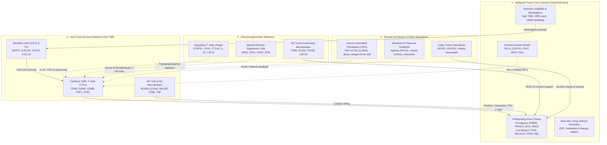
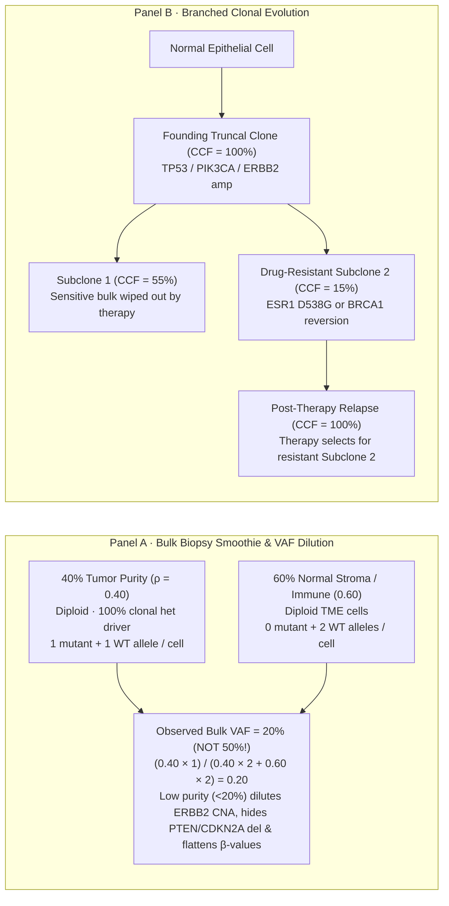
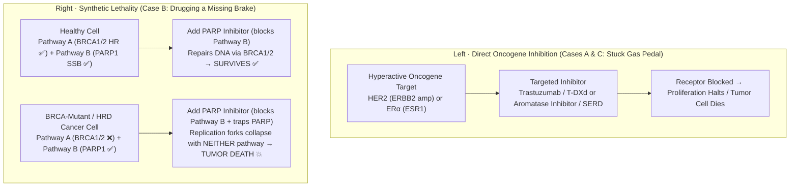

# Cancer Biology 101

> ⚠️ **RESEARCH / EDUCATION ONLY — NOT FOR CLINICAL USE.** This lab runs on
> synthetic or public *research* data with deliberately simplified heuristics. It
> must never be used to diagnose, treat, or inform any medical decision. Real
> molecular tumor boards require board-certified clinicians and accredited
> (CAP/CLIA) laboratories.

Back to [Lab 1B — Agentic Multi-Omics Tumor Board](README.md).

## Understand the biology

In cancer genomics, a single molecular assay rarely tells the whole story. A molecular tumor board integrates complementary biological layers so that structural DNA damage, active transcriptional programs, and epigenetic silencing can be weighed together:

- **DNA (Genome — mutations & copy-number):** Looks for the permanent *hardware damage* in the tumor's blueprint—point mutations (SNVs/indels), focal gene amplifications, deep deletions, and genome-wide mutational signatures (such as Tumor Mutational Burden \[TMB\] and Homologous Recombination Deficiency \[HRD\] genomic scars).
- **RNA (Transcriptome — gene expression, fusions & immune state):** Looks for the active *software state*—which receptors and proliferation programs are actually transcribed (*ESR1*, *PGR*, *ERBB2*, *MKI67*), whether chimeric fusion transcripts are expressed, and whether cytotoxic T cells and interferon-γ signaling are active in the tumor microenvironment ("hot" vs. "cold" immune phenotype).
- **Epigenome (DNA methylation & chromatin architecture):** Looks for *regulatory switches* that silence or activate genes without changing the DNA sequence itself—most classically CpG island promoter hypermethylation that silences DNA-repair or tumor-suppressor genes (such as *BRCA1*, *MLH1*, or *MGMT*), or enhancer hijacking that supercharges oncogenes.
- **Proteome, Metabolome & Spatial/Single-Cell layers (beyond this lab):** Measure whether RNA signals actually translate into cell-surface protein targets and active phosphorylated kinase cascades, whether metabolic rewiring produces oncometabolites, and how tumor clones and immune cells are spatially organized.

### Known Players in a Cancer Tumor & the Tumor Microenvironment (TME)

From a biological standpoint, a solid tumor is **never just a uniform bag of malignant cancer cells**. It is a complex, evolving organ-like ecosystem called the **Tumor Microenvironment (TME)**. Inside a biopsy, malignant subclones actively recruit, corrupt, and battle surrounding host immune cells, fibroblasts, blood vessels, signaling molecules, and extracellular matrix (ECM). When a molecular tumor board reads bulk RNA-seq or spatial data (like Lab 1-b's `immune_infiltration` skill), it is reading the tug-of-war between four major compartments:

- **🔥 Immune-Hot ("Inflamed" TME — e.g., Lab 1-b Case B):** High CD8⁺ T-cell and NK infiltration inside the tumor nest with strong `GZMA` / `PRF1` / `IFNG` / `CXCL9` expression, often triggered by high TMB or *BRCA1/2* HRD neoantigens. Best candidates for **immune-checkpoint blockade (anti-PD-1/PD-L1)**.
- **🧱 Immune-Excluded TME:** CD8⁺ T cells are recruited to the tumor periphery, but a dense ring of **CAFs, collagen ECM, and TGF-β signaling** physically blocks them from entering the malignant nest.
- **❄️ Immune-Cold ("Desert" TME — e.g., Lab 1-b Cases A & C):** Few or no T cells in either core or stroma; low neoantigen load (low TMB), intact DNA repair, or WNT/β-catenin/MYC-driven antigen-presentation silencing.

### Oncogenes ("Stuck Gas Pedals") vs. Tumor Suppressor Genes ("Cut Brakes & Broken Repair Crews")

**Oncogenes**, on the other hand, are genes that normally promote cell growth (proto-oncogenes) but become hyperactive or amplified in cancer. Across all human cancers, the most commonly altered oncogenes include:

- **The RAS Family (*KRAS*, *NRAS*, *HRAS*):** *KRAS* is the most famous and frequently mutated oncogene, driving about 11% to 30% of all human cancers. It is exceptionally common in pancreatic, colorectal, and non-small cell lung cancers.
- ***PIK3CA*:** This gene encodes a key piece of the PI3K signaling pathway, which controls cell survival and metabolism. It is mutated in roughly 12% of all cancers, most notably in breast, endometrial, and colorectal cancers.
- ***BRAF*:** A direct downstream partner of RAS in the signaling chain. *BRAF* mutations (especially the famous V600E mutation) are found in about 8% of all cancers, and are a massive driver in melanoma (found in ~50% of cases), as well as thyroid and colorectal cancers.
- ***MYC*:** Rather than being altered by point mutations, the *MYC* family of transcription factors is most commonly activated by **amplification** (having too many copies of the gene) or chromosomal translocations. *MYC* alterations are found in a huge variety of tumors and leukemias.
- **The *EGFR* / *ERBB* Family:** This family includes *EGFR* and *HER2* (*ERBB2*). These encode growth factor receptors on the cell surface. *EGFR* mutations are common drivers in lung cancer and glioblastoma, while *HER2* amplification is a classic driver in aggressive breast and gastric cancers.

**Tumor Suppressor Genes** are the protective brakes and DNA repair crews of the cell: they normally restrain cell division, trigger programmed cell death (apoptosis), or repair damaged DNA. Unlike oncogenes (where a single activating hit on one allele is enough), tumor suppressors typically require inactivation of **both alleles** (Knudson's "two-hit" hypothesis)—via truncating/missense mutations, copy-number deletion (LOH / deep deletion), or epigenetic promoter hypermethylation. Across human cancers, the most famous tumor suppressors include:

- ***TP53* ("The Guardian of the Genome"):** The single most frequently mutated gene in human cancer (~35%–50% of all tumors, including triple-negative breast, ovarian, lung, and colorectal cancers). It senses DNA damage and halts the cell cycle or triggers apoptosis; when lost, cells divide with catastrophic genomic instability.
- ***BRCA1* & *BRCA2* (Homologous Recombination Repair Caretakers):** Encode critical scaffolding proteins for error-free double-strand DNA break repair. Inactivation (germline + somatic mutation, deletion, or *BRCA1* promoter hypermethylation) causes Homologous Recombination Deficiency (HRD)—driving breast, ovarian, prostate, and pancreatic cancers, while creating synthetic lethality to **PARP inhibitors** and platinum chemotherapy (featured in **Lab 1-b Case B**).
- ***PTEN* (The PI3K/AKT Signaling Brake):** A lipid phosphatase that directly counteracts *PIK3CA*. Frequently lost by point mutation, homozygous deletion, or epigenetic silencing in breast, endometrial, prostate, and glioblastoma tumors, unleashing unchecked PI3K-AKT-mTOR survival signaling.
- ***RB1* (The G1/S Cell-Cycle Gatekeeper):** The first tumor suppressor discovered (in retinoblastoma). Restrains E2F transcription factors to prevent premature entry into S-phase; inactivated in retinoblastoma, small-cell lung cancer (SCLC), osteosarcoma, and endocrine/CDK4/6-inhibitor-resistant breast cancer.
- ***APC* (The Wnt/β-Catenin Gatekeeper):** Truncating *APC* mutations initiate >80% of colorectal carcinomas by failing to degrade β-catenin, locking intestinal epithelial cells into constitutive Wnt-driven proliferation.
- ***CDKN2A* (p16INK4a / p14ARF):** Encodes dual cell-cycle brakes that inhibit CDK4/6 (protecting RB1) and stabilize p53 (inhibiting MDM2). Frequently inactivated by **homozygous deletion** or **promoter hypermethylation** in melanoma, pancreatic, lung, and glioblastoma tumors.
- ***CDH1*, *VHL*, & *ARID1A* (Adhesion, Hypoxia & Chromatin Suppressors):** *CDH1* (E-cadherin; loss drives invasive lobular breast and diffuse gastric cancer), *VHL* (ubiquitin ligase; loss stabilizes HIF-1α/2α in clear-cell renal carcinoma), and *ARID1A* (SWI/SNF chromatin remodeler mutated across gynecologic and GI cancers).

### Epigenetics, the Epigenome & DNA Methylation in Cancer

If the **genome (DNA sequence)** is the cell's permanent hardware blueprint and the **transcriptome (RNA)** is the software currently running, then **epigenetics** is the system of chemical switches and chromatin packaging—collectively called the **epigenome**—that controls which genes are readable and which are locked away **without changing a single A, C, G, or T letter of the DNA sequence**. Every nucleated cell in a patient's body carries essentially the same DNA genome, yet a breast epithelial cell, a T cell, and a neuron express completely different programs because their epigenomes mark active promoters as open **euchromatin** and compact silent regions into dense **heterochromatin**.

The best-characterized epigenetic mark in clinical oncology is **DNA methylation**: the covalent addition of a methyl group (`-CH₃`) to the 5-carbon of cytosine bases at **CpG dinucleotides** (producing **5-methylcytosine, 5mC**). Dense clusters of CpGs—called **CpG islands**—sit in the promoter regions of ~60–70% of human genes. In cancer, two opposite methylation defects frequently co-occur:

- **Focal Promoter Hypermethylation (Gene Silencing):** Dense methylation of a promoter CpG island (measured on arrays or sequencing as a **beta-value β → 1.0**; threshold `β ≥ 0.6` in Lab 1-b's `methylation_analysis` tool) recruits methyl-CpG-binding proteins and histone deacetylases, physically locking the gene in the **"OFF"** state. This acts as an epigenetic "hit" functionally equivalent to a loss-of-function mutation—for example, silencing *BRCA1*, *MLH1*, *CDKN2A*, or *MGMT*.
- **Global Genome-Wide Hypomethylation (Genomic Instability):** Loss of methylation across repetitive elements (LINE-1, Alu) and pericentromeric regions de-condenses chromatin, reactivates transposable elements, and promotes chromosomal breakage and copy-number alterations.

#### Causes of DNA Methylation
DNA methylation is a normal biological mechanism used to lock genes in the "off" position, but it is influenced by both internal programming and external factors:

- **Enzymatic Activity (The "Writers"):** Special enzymes called DNA methyltransferases (DNMTs) physically attach methyl groups to cytosine bases in the DNA.
- **Cellular Differentiation:** As embryos develop, cells use methylation to permanently turn off unneeded genes (e.g., ensuring a neuron doesn't produce liver enzymes).
- **Environmental Exposures:** Toxins (like tobacco smoke and heavy metals) and radiation can trigger abnormal methylation patterns.
- **Diet and Nutrition:** Methyl groups come from our diet. Nutrients like folate, B-vitamins, and choline act as "methyl donors" required to maintain healthy DNA methylation.
- **Aging ("Methylation Drift"):** As we age, our methylation machinery becomes less precise. Some regions become hypermethylated (inappropriately turned off) while others become hypomethylated (inappropriately turned on).
- **Disease-Driven Feedback Loops:** In cancer, mutations often occur in the genes that control methylation enzymes (like *IDH1/2* or *TET2* mutations), causing the tumor to rapidly hypermethylate and silence tumor-suppressor genes.

### Comprehensive Cancer Multi-Omics Reference Table

| Type of Data | Omics / Functional Name | Biological Processes Leading to Cancer | Known Origins / Etiology of These Biological Processes | Instruments & Platforms That Measure It (Common Brands) | Most Common Cancer-Linked Genes & Reference Links |
|---|---|---|---|---|---|
| **DNA — Point Mutations & Small Indels (SNVs/Indels)** *(In Lab 1-b: `mutation_analysis`, `hrd_status`)* | **Genome** (Mutational Ome) | Somatic & germline base substitutions, frameshift/in-frame indels, constitutive kinase activation, premature stop codons, splice-site disruption, and hypermutation (elevated Tumor Mutational Burden \[TMB\]). | DNA polymerase replication slippage; spontaneous 5mC deamination (C>T at CpGs); defective DNA repair (HRD, dMMR, *POLE*/*POLD1* proofreading loss); APOBEC3 enzymatic deamination; exogenous mutagens (UV, tobacco PAHs, alkylating/platinum therapy, ionizing radiation). | **Short-read NGS:** Illumina (NovaSeq X Plus, NextSeq 2000, MiSeq), Element Biosciences (AVITI), Ultima Genomics (UG 100), MGI (DNBSEQ-T7). **Long-read:** PacBio (Revio), Oxford Nanopore (PromethION). **Rapid/Targeted:** Thermo Fisher (Ion Torrent Genexus), Bio-Rad (QX600 ddPCR). | [*TP53*](https://www.oncokb.org/gene/TP53), [*KRAS*](https://www.oncokb.org/gene/KRAS), [*PIK3CA*](https://www.oncokb.org/gene/PIK3CA), [*BRAF*](https://www.oncokb.org/gene/BRAF), [*BRCA1*](https://www.oncokb.org/gene/BRCA1), [*BRCA2*](https://www.oncokb.org/gene/BRCA2), [*EGFR*](https://www.oncokb.org/gene/EGFR), [*APC*](https://www.oncokb.org/gene/APC), [*PTEN*](https://www.oncokb.org/gene/PTEN), [*ARID1A*](https://www.oncokb.org/gene/ARID1A) · [COSMIC Census](https://cancer.sanger.ac.uk/census) · [OncoKB](https://www.oncokb.org/) · [ClinVar](https://www.ncbi.nlm.nih.gov/clinvar/) · [CIViC](https://civicdb.org/) |
| **DNA — Copy-Number Alterations (CNA) & Structural Scars** *(In Lab 1-b: `cna_analysis`, `hrd_status`)* | **Structural Genome** (Copy-Number & Karyotype Ome) | Focal high-level oncogene amplification (chromosomal or extrachromosomal circular DNA \[ecDNA\]), biallelic (homozygous) deletion of tumor suppressors, Loss of Heterozygosity (LOH), telomeric allelic imbalance (TAI), and large-scale state transitions (LST / HRD genomic scarring). | Error-prone NHEJ & MMBIR following double-strand breaks; breakage-fusion-bridge (BFB) cycles from telomere crisis; chromothripsis (chromosome shattering); centrosome amplification & mitotic spindle missegregation (whole-genome doubling / aneuploidy). | **Sequencing:** Illumina (NovaSeq X Plus), PacBio (Revio), Oxford Nanopore (PromethION). **Arrays & Cytogenomics:** Thermo Fisher (Affymetrix OncoScan CNV), Agilent (SurePrint CGH+SNP), Illumina (Infinium CytoSNP), Bionano Genomics (Saphyr optical genome mapping), Abbott (FISH). | **Amplified:** [*ERBB2* (HER2)](https://www.oncokb.org/gene/ERBB2), [*MYC*](https://www.oncokb.org/gene/MYC), [*EGFR*](https://www.oncokb.org/gene/EGFR), [*CCND1*](https://www.oncokb.org/gene/CCND1), [*MDM2*](https://www.oncokb.org/gene/MDM2). **Deleted/LOH:** [*CDKN2A*](https://www.oncokb.org/gene/CDKN2A), [*PTEN*](https://www.oncokb.org/gene/PTEN), [*RB1*](https://www.oncokb.org/gene/RB1), [*BRCA1/2*](https://www.oncokb.org/gene/BRCA1) · [cBioPortal](https://www.cbioportal.org/) · [OncoKB](https://www.oncokb.org/) |
| **RNA — Bulk Gene Expression, Receptors & Immune Signatures** *(In Lab 1-b: `expression_qc`, `receptor_status`, `differential_expression`, `immune_infiltration`, `pathway_enrichment`)* | **Transcriptome** (Functional Expression Ome) | Lineage receptor overexpression (hormone/growth-factor addiction), cell-cycle/mitotic proliferation surge, epithelial-to-mesenchymal transition (EMT), angiogenesis, and tumor microenvironment (TME) immune infiltration (cytotoxic T-cell / IFN-γ "hot" vs. immune-excluded "cold" state). | Upstream genomic amplifications (*ERBB2*); constitutive transcription factor activation (ERα, AR, MYC, HIF-1α); super-enhancer remodeling; neoantigen presentation from high TMB/HRD triggering cGAS-STING and T-cell recruitment (or exhaustion via PD-L1/IDO1). | **RNA-seq:** Illumina (NovaSeq X Plus, NextSeq 2000). **Digital Counting:** NanoString / Bruker (nCounter Pro — PAM50/Prosigna). **RT-qPCR Clinical Assays:** Exact Sciences (Oncotype DX), Agendia (MammaPrint), Cepheid (GeneXpert). | **Receptors/Prolif:** [*ESR1*](https://www.oncokb.org/gene/ESR1), [*PGR*](https://www.oncokb.org/gene/PGR), [*ERBB2*](https://www.oncokb.org/gene/ERBB2), [*MKI67*](https://www.proteinatlas.org/ENSG00000148773-MKI67). **Immune:** *GZMA*, *PRF1*, *IFNG*, *CD8A*, *CXCL9*, *CD274* (PD-L1) · [MSigDB Hallmarks](https://www.gsea-msigdb.org/gsea/msigdb) · [Human Protein Atlas](https://www.proteinatlas.org/) |
| **Epigenetics — Promoter & CpG Island DNA Methylation** *(In Lab 1-b: `methylation_analysis`)* | **Epigenome** (Methylome) | Focal CpG island promoter hypermethylation that transcriptionally silences tumor-suppressor and DNA-repair genes ("epigenetic second hit" mimicking a truncating mutation), plus global hypomethylation causing chromosomal instability. | Dysregulation or mutation of DNA methyltransferases (*DNMT1*, *DNMT3A*) and demethylases (*TET2*); oncometabolite D-2-hydroxyglutarate (from *IDH1/2* mutations) inhibiting TET enzymes (CpG Island Methylator Phenotype \[CIMP\]); aging and chronic inflammation. | **Arrays:** Illumina (Infinium MethylationEPIC v2.0). **Sequencing (WGBS / EM-seq):** Illumina + NEBNext Enzymatic Methyl-seq. **Native 5mC Long-Read:** Oxford Nanopore (PromethION), PacBio (Revio). **Pyrosequencing:** Qiagen (PyroMark Q48). | **Silenced:** [*BRCA1*](https://www.oncokb.org/gene/BRCA1), [*MLH1*](https://www.oncokb.org/gene/MLH1), *MGMT*, [*CDKN2A*](https://www.oncokb.org/gene/CDKN2A), [*PTEN*](https://www.oncokb.org/gene/PTEN), [*RB1*](https://www.oncokb.org/gene/RB1). **Regulators:** [*DNMT3A*](https://www.oncokb.org/gene/DNMT3A), [*TET2*](https://www.oncokb.org/gene/TET2), [*IDH1*](https://www.oncokb.org/gene/IDH1) · [cBioPortal](https://www.cbioportal.org/) · [WashU Epigenome](https://epigenomegateway.wustl.edu/) |
| **Driver Functional Class — Proto-Oncogene Gain-of-Function** *(In Lab 1-b: `mutation_analysis`, `cna_analysis`, `receptor_status`)* | **Oncogenes** ("Stuck Gas Pedals" / Dominant Gain-of-Function Drivers) | Constitutive, ligand-independent activation of mitogenic signaling cascades (RAS-RAF-MEK-ERK, PI3K-AKT-mTOR), receptor tyrosine kinase dimerization, or runaway MYC-driven cell-cycle transcription; requires only a **single mutant or amplified allele**. | Recurrent missense mutations at catalytic/allosteric hotspots (*KRAS* G12C/D/V, *BRAF* V600E, *PIK3CA* H1047R/E545K); high-copy focal gene amplification (*ERBB2*, *MYC*); chromosomal translocations placing proto-oncogenes under super-enhancers. | Measured across **DNA panels/WES** (Illumina NovaSeq, Thermo Ion Torrent), **CNA/FISH** (Abbott PathVysion HER2 FISH, Agilent CGH), **RNA-seq**, and **Clinical IHC** (Roche Ventana HER2 4B5, Agilent Dako). | [*KRAS*](https://www.oncokb.org/gene/KRAS), [*NRAS*](https://www.oncokb.org/gene/NRAS), [*HRAS*](https://www.oncokb.org/gene/HRAS), [*PIK3CA*](https://www.oncokb.org/gene/PIK3CA), [*BRAF*](https://www.oncokb.org/gene/BRAF), [*MYC*](https://www.oncokb.org/gene/MYC), [*EGFR*](https://www.oncokb.org/gene/EGFR), [*ERBB2* (HER2)](https://www.oncokb.org/gene/ERBB2), [*ALK*](https://www.oncokb.org/gene/ALK), [*MET*](https://www.oncokb.org/gene/MET) · [OncoKB](https://www.oncokb.org/) · [COSMIC](https://cancer.sanger.ac.uk/census) |
| **Driver Functional Class — Tumor Suppressor Loss-of-Function** *(In Lab 1-b: `mutation_analysis`, `hrd_status`, `methylation_analysis`)* | **Tumor Suppressor Genes** ("Cut Brakes & Broken Repair Crews") | Loss of G1/S or G2/M cell-cycle checkpoints, evasion of p53-mediated apoptosis, failure of homologous recombination (HRD) or mismatch repair (MSI-H), or unrestrained Wnt/PI3K/hypoxia signaling; classically requires **biallelic ("two-hit") inactivation**. | Inherited germline pathogenic variant (*BRCA1/2*, *TP53*, *APC*, *RB1*) followed by somatic Loss of Heterozygosity (LOH); OR two somatic hits combining nonsense/frameshift/splice mutations, focal homozygous deletion, or CpG promoter hypermethylation. | Measured by combining **Germline + Somatic NGS** (Illumina, Invitae, Ambry, FoundationOne, Tempus xT), **CNA/LOH arrays** (OncoScan), and **Methylation assays** (EPIC array / bisulfite pyrosequencing). | [*TP53*](https://www.oncokb.org/gene/TP53), [*BRCA1*](https://www.oncokb.org/gene/BRCA1), [*BRCA2*](https://www.oncokb.org/gene/BRCA2), [*PTEN*](https://www.oncokb.org/gene/PTEN), [*RB1*](https://www.oncokb.org/gene/RB1), [*APC*](https://www.oncokb.org/gene/APC), [*CDKN2A*](https://www.oncokb.org/gene/CDKN2A), [*CDH1*](https://www.oncokb.org/gene/CDH1), [*VHL*](https://www.oncokb.org/gene/VHL), [*ARID1A*](https://www.oncokb.org/gene/ARID1A) · [OncoKB](https://www.oncokb.org/) · [ClinVar](https://www.ncbi.nlm.nih.gov/clinvar/) · [COSMIC](https://cancer.sanger.ac.uk/census) |
| **RNA — Chimeric Gene Fusions & Pathogenic Splice Isoforms** *(Beyond Lab 1-b)* | **Fusionome & Spliceosome** (Structural Transcriptome) | Expression of constitutively active chimeric kinase fusions (driving ligand-independent proliferation) or exon-skipping splice variants (*MET* exon 14 skipping, *AR-V7*) that confer growth advantage or drug resistance. | Balanced/unbalanced chromosomal translocations, inversions, or interstitial deletions fusing a strong promoter/dimerization domain to a kinase domain; somatic splice-site or spliceosome factor mutations (*SF3B1*, *U2AF1*, *SRSF2*). | **Targeted RNA Fusion Panels:** Illumina (TruSight RNA Fusion), ArcherDX / IDT (FusionPlex AMP), Thermo Fisher (Oncomine Focus). **Full-Length Isoform Sequencing:** PacBio (Iso-Seq on Revio), Oxford Nanopore (Direct RNA / cDNA). | [*EML4-ALK*](https://www.oncokb.org/gene/ALK), [*RET*](https://www.oncokb.org/gene/RET), [*ROS1*](https://www.oncokb.org/gene/ROS1), [*NTRK1/2/3*](https://www.oncokb.org/gene/NTRK1), [*BCR-ABL1*](https://www.oncokb.org/gene/ABL1), [*TMPRSS2-ERG*](https://www.oncokb.org/gene/ERG), [*MET* ex14](https://www.oncokb.org/gene/MET), [*SF3B1*](https://www.oncokb.org/gene/SF3B1) · [OncoKB Fusions](https://www.oncokb.org/) · [CIViC](https://civicdb.org/) |
| **Epigenetics — Chromatin Accessibility, Histone Marks & 3D Topology** *(Beyond Lab 1-b)* | **Chromatin & Cistrome** (ATAC-seq, ChIP-seq, CUT&RUN, Hi-C) | De novo formation of oncogenic super-enhancers, Polycomb (H3K27me3) repression of differentiation programs, loss of TAD boundary insulation ("enhancer hijacking"), and pioneer-factor reprogramming of lineage plasticity. | Inactivating mutations in SWI/SNF chromatin remodelers (*ARID1A*, *SMARCB1*, *SMARCA4*); histone modifier mutations (*EZH2*, *KMT2D*, *KMT2A*); oncohistone mutations (*H3F3A* K27M); CTCF binding-site methylation. | **Chromatin & 3D Assays:** 10x Genomics (Chromium Single Cell ATAC & Multiome), Illumina (NovaSeq for ATAC-seq, ChIP-seq, CUT&Tag), Phase Genomics / Arima Genomics (Hi-C), Active Motif, Diagenode. | [*ARID1A*](https://www.oncokb.org/gene/ARID1A), [*SMARCA4*](https://www.oncokb.org/gene/SMARCA4), [*EZH2*](https://www.oncokb.org/gene/EZH2), [*KMT2D*](https://www.oncokb.org/gene/KMT2D), [*EP300*](https://www.oncokb.org/gene/EP300), [*FOXA1*](https://www.oncokb.org/gene/FOXA1), *CTCF* · [ENCODE](https://www.encodeproject.org/) · [cBioPortal](https://www.cbioportal.org/) |
| **Proteins — Total Protein Abundance & Phospho-Signaling** *(Beyond Lab 1-b)* | **Proteome & Phosphoproteome** (Functional Signaling Ome) | Post-transcriptional discordance (mRNA present but protein degraded, or vice versa), cell-surface receptor density (governing ADC payload delivery), and hyperactive kinase phosphorylation cascades (p-AKT, p-ERK, p-STAT3) even without a canonical DNA mutation. | Altered ribosomal translation initiation (eIF4E/mTORC1); ubiquitin-proteasome degradation defects (*VHL*, *FBXW7*); constitutive receptor tyrosine kinase autophosphorylation; phosphatase loss (*PTEN*, *PTPN11*). | **Mass Spectrometry (LC-MS/MS):** Thermo Fisher (Orbitrap Astral, Orbitrap Exploris 480), Bruker (timsTOF Pro 2 / HT), SCIEX (ZenoTOF 7600). **Clinical IHC & High-Plex Affinity:** Roche Ventana (BenchMark ULTRA), Agilent Dako, Olink (Explore HT), SomaLogic (SomaScan). | [HER2 (*ERBB2*)](https://www.oncokb.org/gene/ERBB2), ERα (*ESR1*), PD-L1 (*CD274*), [p-AKT1](https://www.oncokb.org/gene/AKT1), [mTOR](https://www.oncokb.org/gene/MTOR), [p-EGFR](https://www.oncokb.org/gene/EGFR), TROP2 (*TACSTD2*) · [NCI CPTAC](https://proteomics.cancer.gov/programs/cptac) · [Human Protein Atlas](https://www.proteinatlas.org/) |
| **Cellular & Tissue Resolution — Single-Cell & Spatial Profiles** *(Beyond Lab 1-b)* | **Single-Cell & Spatial Ome** (scRNA-seq, Spatial Transcriptomics & Proteomics) | Intratumoral clonal heterogeneity, rare drug-tolerant persister subpopulation emergence, cancer-associated fibroblast (CAF) stromal barriers, and physical immune exclusion (CD8+ T cells trapped in stroma away from tumor nests). | Subclonal branched evolution under Darwinian therapy pressure; paracrine cytokine cross-talk (TGF-β, CXCL9/10); hypoxic gradients and extracellular matrix (ECM) remodeling across the tumor bed. | **Single-Cell:** 10x Genomics (Chromium X), BD (Rhapsody), Mission Bio (Tapestri scDNA). **Spatial:** 10x Genomics (Visium HD, Xenium In Situ), NanoString/Bruker (GeoMx DSP, CosMx SMI), Vizgen (MERSCOPE), Akoya Biosciences (PhenoCycler-Fusion), Standard BioTools (Hyperion IMC). | Clonal & niche markers: [*ERBB2*](https://www.oncokb.org/gene/ERBB2), [*ESR1*](https://www.oncokb.org/gene/ESR1), *CD8A*, *FOXP3*, *PDCD1* (PD-1), *CD274* (PD-L1), *FAP*, *ACTA2*, *CXCL9* · [Human Cell Atlas](https://www.humancellatlas.org/) · [NCI HTAN](https://humantumoratlas.org/) |
| **Metabolites — Small-Molecule Flux & Oncometabolites** *(Beyond Lab 1-b)* | **Metabolome & Lipidome** | Aerobic glycolysis (Warburg effect), glutaminolysis addiction, de novo lipogenesis, accumulation of epigenetic-poisoning oncometabolites (D-2-hydroxyglutarate, succinate, fumarate), and immunosuppressive tryptophan-kynurenine/adenosine accumulation in the TME. | Neomorphic mutations in TCA-cycle enzymes (*IDH1*, *IDH2*, *SDHA/B/C/D*, *FH*); MYC/HIF-1α/PI3K-AKT metabolic reprogramming; tumor hypoxia and nutrient competition with infiltrating T cells. | **Mass Spec & NMR:** Thermo Fisher (Orbitrap IQ-X / Q Exactive GC-MS & LC-MS), Agilent (6546 Q-TOF, Seahorse XF Analyzer), Waters (SYNAPT XS), Bruker (Avance NEO NMR, timsTOF Spatial MALDI-MSI). | [*IDH1*](https://www.oncokb.org/gene/IDH1), [*IDH2*](https://www.oncokb.org/gene/IDH2), [*SDHB*](https://www.oncokb.org/gene/SDHB), [*FH*](https://www.oncokb.org/gene/FH), *IDO1*, *FASN*, *GLS*, *LDHA* · [HMDB](https://hmdb.ca/) · [KEGG Metabolic Pathways](https://www.kegg.jp/) |
| **Biofluids — Circulating Cell-Free Tumor DNA/RNA & Methylation** *(Beyond Lab 1-b)* | **Circulating Ome / Liquid Biopsy** (ctDNA, cfRNA, Fragmentome, CTCs) | Non-invasive shedding of tumor DNA fragments into peripheral blood, revealing minimal residual disease (MRD) after surgery, early polyclonal resistance mutations (*ESR1* LBD, *EGFR* T790M/C797S) months before radiographic progression, and tissue-of-origin methylation signatures. | Apoptosis, necrosis, and active vesicular secretion from primary and metastatic tumor deposits releasing ~145–166 bp nucleosome-wrapped cell-free DNA fragments into the bloodstream. | **Ultra-deep Duplex NGS & ddPCR:** Illumina (NovaSeq X Plus + TruSight Oncology 500 ctDNA), Bio-Rad (QX600 ddPCR), Guardant Health (Guardant360 / Reveal), Foundation Medicine (FoundationOne Liquid CDx), Natera (Signatera MRD), Grail (Galleri cfDNA methylation). | Resistance & MRD trackers: [*ESR1*](https://www.oncokb.org/gene/ESR1) (D538G, Y537S), [*PIK3CA*](https://www.oncokb.org/gene/PIK3CA), [*EGFR*](https://www.oncokb.org/gene/EGFR), [*KRAS*](https://www.oncokb.org/gene/KRAS), [*BRCA1/2*](https://www.oncokb.org/gene/BRCA1) reversion mutations · [OncoKB](https://www.oncokb.org/) · [CIViC](https://civicdb.org/) |

### Somatic vs. Germline Variants — and Driver vs. Passenger Mutations

Before any variant can be interpreted clinically, a cancer bioinformatician must separate two orthogonal biological axes: **where the variant came from (Germline vs. Somatic)** and **what it does to the tumor's fitness (Driver vs. Passenger)**.

1. **Tissue of Origin — Germline vs. Somatic:**
   - **Germline variants** are inherited from a parent (present in the fertilized egg and therefore in **every nucleated cell** of the body, typically at ~50% heterozygous or ~100% homozygous Variant Allele Frequency \[VAF\]). Most are benign human polymorphisms (~4–5 million per genome), while a rare few confer hereditary cancer predisposition (e.g., germline *BRCA1/2*, *TP53* Li-Fraumeni, *APC*, *MLH1/MSH2* Lynch syndrome).
   - **Somatic variants** arise *de novo* in a single somatic cell during life and are restricted to the tumor clone (and its metastases). Because a tumor genome carries thousands of somatic changes alongside millions of inherited germline variants, gold-standard cancer genomics sequences a **matched tumor–normal pair** (tumor biopsy + peripheral blood/saliva) and subtracts the normal BAM/VCF (using somatic callers like `Mutect2`, `Strelka2`, or `SomaticSniper`).
2. **Functional Impact — Driver vs. Passenger Mutations:**
   - **Driver mutations (~2 to 8 per solid tumor):** Confer a direct Darwinian fitness advantage (faster division, evasion of apoptosis, invasion) by activating an oncogene or disabling a tumor suppressor. They recur at the same amino-acid hotspots (*KRAS* G12C, *BRAF* V600E, *PIK3CA* H1047R) or scatter as truncating hits across a tumor suppressor (*TP53*, *BRCA1*).
   - **Passenger mutations (>99% of somatic mutations in a tumor):** Random background mutations that occurred in non-coding or non-essential regions before or during clonal expansion and simply "hitchhiked" along with the driver clone.

| Variant Class | Present in Normal Blood? | Typical Observed VAF | Clinical & Biological Meaning | How Lab 1-b Uses It |
|---|---|---|---|---|
| **Germline Driver** (Pathogenic Predisposition) | **Yes** (every cell in body) | ~50% (heterozygous) or rises to 70–90% in tumor after somatic LOH of the wild-type allele | Hereditary cancer syndrome (e.g., germline *BRCA1/2*, *PALB2*, *TP53*, *MLH1*). Directs both patient targeted therapy (PARP inhibitors) and family cascade genetic counseling. | Flagged in `mutation_analysis` (*BRCA1/2* pathogenic hit) and triggers `hrd_status` + PARP inhibitor routing. |
| **Somatic Driver** (Acquired Oncogenic Hit) | **No** (tumor-restricted) | Scales with tumor purity & clonality (typically 5%–60% in bulk biopsies; <1–5% in liquid biopsy ctDNA) | Directly drives tumor proliferation, survival, or drug resistance (e.g., *PIK3CA* H1047R, *ERBB2* amp, somatic *TP53* R175H, *ESR1* D538G). | Extracted in `mutation_analysis` (`drivers` list) and `cna_analysis` to select targeted therapy classes. |
| **Somatic Passenger** (Clonal Hitchhiker) | **No** (tumor-restricted) | Scales with the clone/subclone it hitchhiked in | Neutral to tumor growth on its own—**but** nonsynonymous passengers create foreign mutated peptides (**neoantigens**) presented on MHC-I to CD8⁺ T cells, and their trinucleotide patterns record mutagen history. | Counted in `mutation_analysis` (`mutation_burden_count / 38.0`) to compute **TMB (mut/Mb)** and trigger `immune_infiltration`. |

> **Why passenger mutations are NOT useless noise in Lab 1-b (`mutation_analysis`):** While `mutation_analysis` filters specifically for pathogenic **drivers** (*TP53*, *PIK3CA*, *BRCA1/2*) to guide targeted therapy, it counts **all nonsynonymous somatic mutations (mostly passengers!)** across the 38 Mb exome footprint (`mutation_burden_count / 38.0`) to calculate **Tumor Mutational Burden (TMB)**, because passenger mutations still generate foreign **neoantigens** that make the tumor visible to CD8⁺ T cells!

### Tumor Purity, Ploidy & Clonal Evolution ("The Bulk Smoothie Problem")

A bulk biopsy is a physical **"smoothie"** of malignant clones and normal TME cells (stroma, endothelial cells, T cells, macrophages). Ignoring **Tumor Purity** ($\rho$), **Ploidy** ($\psi$), and **Clonality** (Cancer Cell Fraction, CCF) is the #1 quantitative trap in cancer bioinformatics:

- **Tumor Purity ($\rho$) & VAF Dilution:** In a diploid tumor with **40% Tumor Purity** ($\rho = 0.40$) and **60% Normal Stroma/Immune Cells** ($\rho_{\text{normal}} = 0.60$), a heterozygous truncal mutation present in 100% of cancer cells (1 mutant allele out of 2 per tumor cell) yields an observed bulk **Variant Allele Frequency (VAF) of only 20%** ($\text{VAF} = \frac{0.40 \times 1}{0.40 \times 2 + 0.60 \times 2} = 0.20$), NOT 50%! Low purity (<20%) dilutes focal CNA amplifications (`ERBB2`), hides homozygous deletions (`PTEN`/`CDKN2A`), and pulls promoter methylation $\beta$-values toward normal tissue baselines.
- **Tumor Ploidy ($\psi$) & Whole-Genome Doubling (WGD):** ~30–40% of solid tumors undergo Whole-Genome Doubling to 3$n$–4$n$. Callers (`ABSOLUTE`, `ASCAT`, `facets`, `sequenza`) jointly model $\rho$ and $\psi$ so baseline tetraploidy is not miscalled as focal gene amplification.
- **Truncal vs. Subclonal Targeting (CCF):** Converting raw VAF + purity + local copy number yields the **Cancer Cell Fraction (CCF)**. Targeting a **truncal driver (CCF = 100%)** treats every cell in the tumor, whereas therapy pressure can wipe out a sensitive subclone (CCF = 55%) while selecting for a pre-existing **drug-resistant subclone (CCF = 15%, e.g., *ESR1* D538G or *BRCA1* reversion)** that drives clinical relapse.

### Genome-Wide Mutational Signatures: TMB, HRD ("Genomic Scars"), and MSI

Some of the strongest clinical biomarkers in oncology are not single-gene mutations, but **genome-wide mathematical patterns** left behind by broken DNA repair or mutagen exposure:

1. **Tumor Mutational Burden (TMB — mut/Mb):** Total nonsynonymous somatic mutations per megabase of coding DNA (`≥ 10 mut/Mb` FDA pan-cancer threshold used in Lab 1-b's `mutation_analysis`). High TMB increases the probability that mutated peptides bind MHC-I as **neoantigens**, priming an anti-PD-1/PD-L1 immunotherapy response (when antigen presentation is intact).
2. **Homologous Recombination Deficiency (HRD) & "Genomic Scars":** When error-free homologous recombination is lost (via *BRCA1/2*, *PALB2*, *RAD51C/D* mutation or *BRCA1* promoter hypermethylation), the cell falls back on error-prone Non-Homologous End Joining (NHEJ) and Microhomology-Mediated End Joining (MMEJ). Over hundreds of cell divisions, this leaves three permanent structural scars across the chromosomes:
   - **LOH (Loss of Heterozygosity):** Intermediate-sized regions (>15 Mb, smaller than a whole chromosome) where one parental copy is lost.
   - **TAI (Telomeric Allelic Imbalance):** Allelic copy-number imbalance extending all the way to the subtelomere without crossing the centromere.
   - **LST (Large-Scale State Transitions):** Chromosomal breaks ≥10 Mb apart between adjacent segments.
   - **The GIS / HRD Score (`hrd_status` in Lab 1-b):** Clinical assays (e.g., Myriad myChoice CDx) sum $\text{LOH} + \text{TAI} + \text{LST}$; a score **$\ge 42$** (or a pathogenic *BRCA1/2* mutation) calls the tumor **HRD-positive**, predicting sensitivity to **PARP inhibitors** and **platinum chemotherapy**.
3. **Microsatellite Instability (MSI-H / dMMR):** Inactivation of DNA mismatch repair (*MLH1*, *MSH2*, *MSH6*, *PMS2*—often via *MLH1* promoter hypermethylation) causes thousands of insertions/deletions at repetitive microsatellite tracts, producing extreme hypermutation (TMB often >30–100 mut/Mb) and strong sensitivity to immune-checkpoint blockade.
4. **COSMIC Mutational Signatures (SBS1–SBS96):** Deconvolving SNVs into their 96 trinucleotide contexts (`5'-base [C>A/G/T or T>A/C/G] 3'-base`) reveals the exact mutagen or enzymatic defect—such as **SBS1** (aging / 5mC deamination), **SBS2 & SBS13** (APOBEC cytidine deaminases), **SBS3** (HRD / *BRCA1/2* failure), **SBS4** (tobacco smoking), **SBS6/15/26** (dMMR), and **SBS7** (UV light).

### From Biomarker to Therapy: Direct Inhibition vs. Synthetic Lethality & Evidence Tiers

*"Why can you drug an overactive oncogene directly, and how on earth do you drug a tumor suppressor when its protein is already missing?"*

#### Clinical Actionability Tiers (AMP/ASCO/CAP Tiers I–IV & OncoKB Levels 1–4 & Resistance)

| Tier / OncoKB Level | Clinical Meaning | Examples & Lineage Context |
|---|---|---|
| **Tier I / OncoKB Level 1–2** *(Standard-of-Care Biomarker)* | FDA-approved or guideline-backed biomarker in *that specific tumor type*. | *ERBB2* amplification → anti-HER2 in breast cancer (Case A); *BRCA1/2* or HRD → PARP inhibitor (Case B); ER+/HER2− → endocrine therapy (Case C). |
| **Tier II / OncoKB Level 3A–3B** *(Investigational / Off-Label)* | Compelling clinical trial evidence or standard-of-care in *another* tumor type. | **Lineage context warning:** *BRAF* V600E monotherapy works in melanoma but fails in colorectal cancer without concurrent EGFR blockade due to feedback reactivation. |
| **Tier III (VUS)** *(Variants of Unknown Significance)* | Somatic or germline missense changes with insufficient functional or population evidence. | Must **never** be used to select clinical therapy. |
| **Resistance Biomarkers** *(OncoKB Level R1/R2)* | Mutations that predict *lack* of benefit or acquired relapse. | *KRAS*/*NRAS* mutations → resistance to anti-EGFR antibodies in CRC; *ESR1* LBD mutations → resistance to aromatase inhibitors; *BRCA1/2* reversion mutations → resistance to PARP inhibitors. |

### The Hallmarks of Cancer — Unifying Multi-Omics into Biological Capabilities

Hanahan & Weinberg's **Hallmarks of Cancer** serve as the master conceptual map connecting every row of the multi-omics reference table to what a tumor cell actually *does* biologically:

| # | Hallmark of Cancer | Primary Omics Layer(s) That Detect It | Canonical Genes / Pathways | Corresponding Tool in Lab 1-b (`src/omics.py`) |
|---|---|---|---|---|
| 1 | **Sustaining Proliferative Signaling** | DNA (mutations/CNA), RNA (expression), Phosphoproteome | *ERBB2*, *EGFR*, *KRAS*, *BRAF*, *PIK3CA*, *ESR1*, *MKI67* | `receptor_status`, `cna_analysis`, `mutation_analysis`, `pathway_enrichment` |
| 2 | **Evading Growth Suppressors** | DNA (truncating mutations, deep deletions), Epigenome (hypermethylation) | *RB1*, *TP53*, *PTEN*, *CDKN2A*, *APC* | `mutation_analysis`, `cna_analysis`, `methylation_analysis` |
| 3 | **Genome Instability & Mutation** *(Enabling Hallmark)* | DNA (WES/WGS somatic variants, CNA scars) | *BRCA1*, *BRCA2*, *TP53*, *MLH1*, *MSH2*, *POLE* | `mutation_analysis` (TMB), `hrd_status` (HRD score) |
| 4 | **Avoiding Immune Destruction** | RNA (TME immune signatures), Spatial Ome, DNA (neoantigens / HLA LOH) | *CD8A*, *GZMA*, *PRF1*, *IFNG*, *CXCL9*, *CD274* (PD-L1), *FOXP3* | `immune_infiltration`, `mutation_analysis` (TMB) |
| 5 | **Nonmutational Epigenetic Reprogramming** *(Enabling Hallmark)* | Epigenome (Methylation arrays/WGBS, ATAC-seq, ChIP-seq) | *BRCA1* / *MLH1* / *CDKN2A* promoter CpG islands, *DNMT3A*, *TET2*, *ARID1A*, *EZH2* | `methylation_analysis` |
| 6 | **Resisting Cell Death (Apoptosis)** | DNA, RNA, Proteome | *TP53*, *BCL2* amp/translocation, *MCL1*, *BAX*, *PIK3CA*/*AKT1* | `mutation_analysis`, `pathway_enrichment` |
| 7 | **Deregulating Cellular Metabolism** | Metabolome, RNA, DNA | *IDH1*, *IDH2*, *MYC*, *HIF1A*, *LDHA*, *IDO1* | `pathway_enrichment` (PI3K-AKT-mTOR / MYC) |
| 8 | **Activating Invasion & Metastasis** | RNA (EMT programs), DNA, Spatial Ome, Liquid Biopsy (ctDNA) | *CDH1* (E-cadherin loss), *TWIST1*, *SNAI1*, *VIM*, *TGFB1* | `mutation_analysis` (*CDH1*), `differential_expression` |
| 9 | **Inducing / Accessing Vasculature (Angiogenesis)** | RNA, Proteome, Spatial TME | *VEGFA*, *KDR* (VEGFR2), *VHL*, *HIF1A*, *ANGPT2* | `differential_expression` *(Beyond Lab 1-b)* |
| 10 | **Enabling Replicative Immortality** | DNA (promoter WGS/panels), RNA | *TERT* promoter mutations (-124C>T, -146C>T), *ATRX*/*DAXX* (ALT pathway) | *(Beyond Lab 1-b)* |
